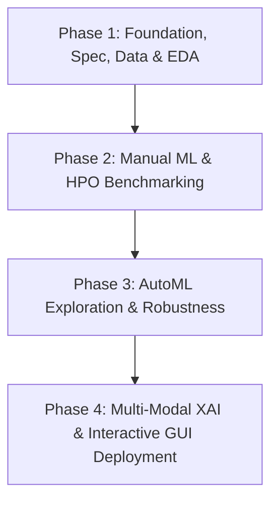

# Master 4-Phase Implementation Plan
## Explainable AutoML for Predictive Maintenance

This master project combines two core subjects: **AutoML** and **Explainable AI (XAI)**. The project is executed across four disciplined phases ensuring complete scientific rigor, reproducibility, and academic rubric compliance.

---

---

## Phase 1: Project Foundation, Specification, Data Pipeline, and EDA (Current Phase)
- **Objective:** Establish the complete project structure, locked architectural decisions, automated data loading, synthetic fallback generator, stratified preprocessing pipelines, and exploratory data analysis (EDA).
- **Key Tasks:**
  1. Build standardized directory structure (`data/`, `src/`, `scripts/`, `models/`, `results/`, `plots/`, `reports/`, `app/`, `slides/`).
  2. Implement configuration (`src/config.py`) and reproducible utilities (`src/utils.py`).
  3. Implement raw data discovery and ingestion (`src/data/load_data.py`) with automatic schema mapping.
  4. Implement physics-based synthetic data generator (`src/data/generate_synthetic.py`) matching AI4I 2020 distributions with ~3.5-5.0% failure imbalance.
  5. Build dual preprocessing pipelines (`src/data/preprocess.py`):
     - **Manual ML:** Median numeric imputation, mode categorical imputation, one-hot encoding for `type`.
     - **AutoML:** Clean continuous variables with native string categorical typing.
  6. Generate comprehensive EDA summaries (dataset summary, missing values, class distributions, feature statistics) and visualizations (histograms, KDEs, correlation heatmap, imbalance chart).
  7. Author report outlines for AutoML and XAI final submissions.
  8. Validate Phase 1 deliverables via `scripts/validate_phase1.py`.
- **Outputs & Deliverables:**
  - `data/processed/train_manual.csv`, `test_manual.csv`
  - `data/processed/train_automl.csv`, `test_automl.csv`
  - `data/processed/metadata.json`
  - `results/` summary CSV tables and `plots/` visualization PNGs
  - `PROJECT_SPEC.md`, `PLAN.md`, `ASSUMPTIONS.md`, `README.md`, `DOWNLOAD_INSTRUCTIONS.md`

---

## Phase 2: Manual Machine Learning Baseline and Hyperparameter Tuning
- **Objective:** Establish rigorous manual machine learning baselines and benchmark hyperparameter optimization (HPO) paradigms on identical validation folds.
- **Key Tasks:**
  1. Implement baseline classifiers in scikit-learn:
     - Dummy Classifier (majority class baseline).
     - Logistic Regression (with StandardScaler).
     - Random Forest Classifier (default parameters).
     - HistGradientBoostingClassifier.
  2. Implement 5-fold stratified cross-validation on `train_manual.csv`.
  3. Conduct systematic Hyperparameter Tuning across identical search spaces:
     - **Grid Search (`GridSearchCV`):** Exhaustive grid over key tree parameters (depth, estimators, min_samples_split).
     - **Random Search (`RandomizedSearchCV`):** Stochastic continuous sampling over distributions.
     - **Optuna:** Bayesian optimization using Tree-structured Parzen Estimators (TPE) with pruning.
  4. Measure wall-clock optimization duration, convergence iterations, and F1-score trajectories.
  5. Evaluate top tuned model on pristine `test_manual.csv` partition.
  6. Generate comparative tables and convergence trajectory plots.
- **Outputs & Deliverables:**
  - `results/manual_baseline_results.csv`
  - `results/hpo_comparison_results.csv`
  - `plots/hpo_convergence_comparison.png`
  - Serialized best manual model (`models/best_manual_model.joblib`)

---

## Phase 3: AutoML Experiments, Leakage Testing, and Bias Analysis
- **Objective:** Benchmark automated machine learning frameworks (FLAML and AutoGluon) under identical fixed time budgets, evaluate resistance to data leakage, and inspect subgroup fairness.
- **Key Tasks:**
  1. Setup benchmarking harness with strict wall-clock time budgets:
     - CI/Agent testing budget: $60\text{ seconds}$.
     - Final benchmarking budget: $900\text{ seconds}$ ($15\text{ minutes}$).
  2. **FLAML Experiment:**
     - Run cost-effective AutoML search optimizing for F1-score.
     - Log candidate models evaluated (LightGBM, XGBoost, CatBoost, ExtraTrees).
  3. **AutoGluon-Tabular Experiment:**
     - Train multi-layer stacking ensemble with `'best_quality'` preset.
     - Extract full leaderboard, individual model performance, and ensemble weights.
  4. **Controlled Data Leakage Experiment:**
     - Synthesize a deliberately leaky feature (e.g., post-failure indicator).
     - Train manual baseline vs. AutoML on leaky dataset.
     - Quantify whether AutoML blindly exploits the leakage or issues diagnostics.
  5. **Class Imbalance & Group Bias Evaluation:**
     - Compare performance across machine types (L vs. M vs. H).
     - Assess threshold-moving strategies and class weighting impact on minority recall.
- **Outputs & Deliverables:**
  - `results/automl_leaderboard_flaml.csv`
  - `results/automl_leaderboard_autogluon.csv`
  - `results/leakage_experiment_results.csv`
  - `results/bias_group_fairness.csv`
  - Serialized best AutoML pipeline artifact

---

## Phase 4: Multi-Modal Explainable AI (XAI), Decision Support, and GUI Deployment
- **Objective:** Implement comprehensive model explainability across tabular telemetry, image inspection, and technician text logs, integrating everything into an interactive Streamlit application.
- **Key Tasks:**
  1. **Tabular Explainability Engine:**
     - **SHAP (Shapley Additive Explanations):** Compute global summary beeswarm, mean absolute $|\phi_i|$ rankings, and individual local waterfall/force plots.
     - **LIME:** Compute sparse local linear surrogate explanations with interpretable decision rules.
     - **Partial Dependence Plots (PDP) & ICE:** Compute 1D and 2D marginal response curves for `tool_wear`, `torque`, and `rotational_speed`.
     - **What-If / Counterfactual Analysis:** Minimal parameter adjustments required to rescue an at-risk machine.
  2. **Domain Action Translation:**
     - Map Shapley attribution drivers into concrete factory maintenance work orders (e.g., coolant flush for thermal margin collapse, cutting insert replacement for wear).
  3. **Multi-Modal XAI Demonstrations:**
     - **Image XAI:** Thermal crack inspection imagery demo with Grad-CAM saliency heatmaps.
     - **Text XAI:** Shift technician incident log classification with token attribution highlights.
  4. **Interactive Streamlit GUI Application:**
     - Telemetry simulator sliders with live risk gauge.
     - Global and local interactive XAI tabs.
     - Multi-modal demonstration tabs.
  5. **Final Project Assets:**
     - Complete Hugging Face style Model Card.
     - Academic report draft compilation and slide decks.
- **Outputs & Deliverables:**
  - `app/app.py` (Streamlit interactive GUI)
  - `plots/shap_summary_beeswarm.png`, `plots/shap_waterfall_example.png`
  - `plots/lime_explanation_example.png`, `plots/pdp_tool_wear.png`
  - `reports/AutoML_Final_Report.md`, `reports/XAI_Final_Report.md`
  - `slides/predictive_maintenance_presentation.pdf` (or markdown slides)
